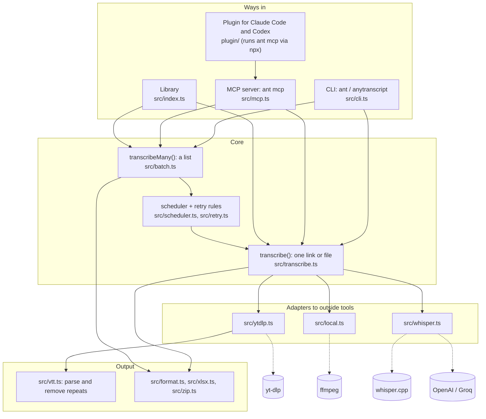
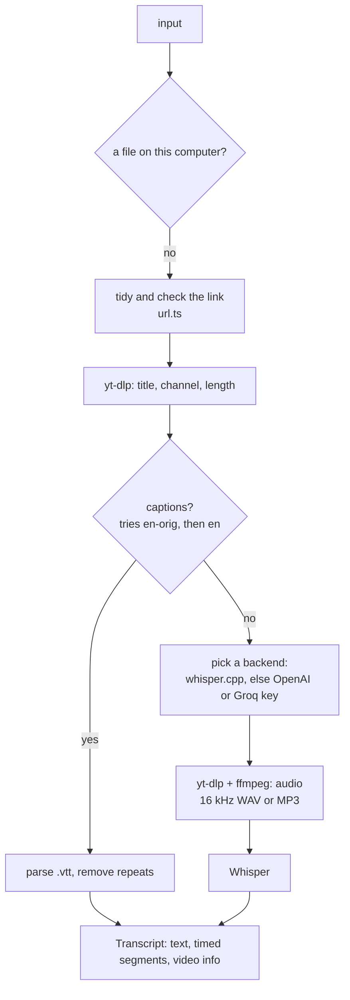
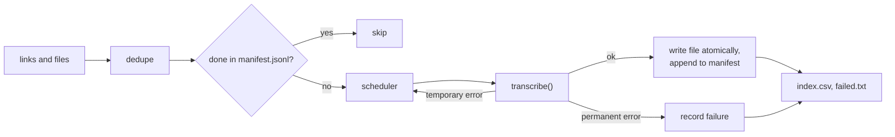

# Architecture

anytranscript turns a video link or a media file into a timestamped
transcript. It does not download or recognise speech itself. It drives four
outside tools (yt-dlp, ffmpeg, whisper.cpp, or a hosted Whisper API) and owns
everything around them: picking the path, cleaning the text, saving files,
running long lists, and giving agents a tool to call.

This page covers what those tools do, what this package adds on top, how the
code is laid out, and why it is built this way.

## What it wraps, and what it adds

| Outside tool | What it does here | What it doesn't do (and this package does) |
|---|---|---|
| [yt-dlp](https://github.com/yt-dlp/yt-dlp) | Reaches the video on 1,800+ sites. Reads its title, channel and length. Pulls a caption track or the best audio. | Choosing captions or audio. Removing the 3× repeats in auto-captions. Picking the right YouTube caption track. Retrying, pacing and resuming a list. Saving Markdown, Excel or subtitles. Installing itself. |
| [ffmpeg](https://ffmpeg.org) | Converts audio to what Whisper needs. yt-dlp calls it for links; this package calls it directly for files on the computer. | Knowing which format each Whisper engine wants. Explaining "no audio track" in plain words. |
| [whisper.cpp](https://github.com/ggml-org/whisper.cpp) | Speech to text on the user's own machine. | Downloading and checking model weights. Running one job at a time so jobs don't fight over the CPU. Turning its JSON into timed segments. |
| OpenAI / Groq Whisper APIs | Speech to text in the cloud, for machines without whisper.cpp. | Choosing a backend from what is installed or which key is set. Keeping uploads small. |

In one line: **the outside tools get the bytes and the words; anytranscript
decides, cleans, saves, schedules and serves.**

### The additions, in order of value

1. **Duplicate removal in auto-captions.** YouTube's auto-captions repeat each
   line across two or three cues to fake scrolling. Stripping the timing lines
   leaves the text tripled: 55,319 characters on one 20-minute video against
   18,430 after `src/vtt.ts`. An LLM reading the raw version pays three times
   over for a stutter.
2. **Captions first, Whisper second.** YouTube usually has captions; Instagram
   and TikTok almost never do. `src/transcribe.ts` asks for captions and drops
   to speech recognition only when there are none, so the caller doesn't need
   to know which kind of site it is.
3. **The speech recognition path end to end.** Audio extraction, the model
   download with a checksum, the call to the engine and parsing its output.
   yt-dlp stops at the audio file.
4. **Files on the computer.** A path skips yt-dlp. ffmpeg reads the audio
   track and Whisper does the rest (`src/local.ts`).
5. **Lists that finish.** Hundreds of links with retries, per-site spacing,
   backoff on rate limits, timeouts, and resume after a crash
   (`src/batch.ts`, `src/scheduler.ts`, `src/retry.ts`).
6. **Files people open.** Markdown, CSV, Excel, SRT, VTT, JSON and text, all
   built from the same timed segments (`src/format.ts`, `src/xlsx.ts`).
7. **A tool for agents.** `ant mcp` is an MCP server with `transcribe` and
   `transcribe_many`, and `plugin/` packages it with a skill for Claude Code
   and Codex.
8. **Forgiving input.** Quotes, a `url=` prefix, chat-app `<...>` wrappers,
   invisible characters and bare `youtube.com/...` links are cleaned up. Bad
   input stops before any download, with a reason (`src/url.ts`).

### What it leaves to the outside tools on purpose

It doesn't reimplement any site or get around logins and blocks. A site that
needs a login gets the user's browser cookies, passed straight to yt-dlp. When
a site changes, updating yt-dlp is the fix, not a release of this package.

## The big picture

Every way in ends at the same two functions, `transcribe()` and
`transcribeMany()`. The CLI and the MCP server only parse input and present
results, so a fix in the core reaches all of them at once.

## How one request flows

### A link

The `<lang>-orig` step matters: YouTube serves a video's original
auto-captions under `en-orig` and keeps `en` for machine translations, which
are heavily rate-limited. Asking for `en-orig` first avoids most HTTP 429s.

### A file on this computer

`localMediaPath()` decides first. Anything that looks like a path (`/`, `./`,
`~/`, `C:\`, `file://`) or names a file that exists is treated as a file.
Then:

1. Check it: missing, a folder, empty, or blocked by macOS privacy settings
   each stop with a reason.
2. ffmpeg reads the first audio track: a 16 kHz mono WAV for whisper.cpp, or
   a 64 kbit/s mono MP3 for a hosted API (they cap uploads at 25 MB, about 50
   minutes at that rate). Its `Duration:` line gives the length.
3. Whisper transcribes it. yt-dlp never runs.

### A list

- **Scheduler** (`src/scheduler.ts`): 3 jobs at once by default, a 2-second
  gap between starts on the same site, a wider gap after a rate limit, and
  jittered exponential backoff that doesn't hold a slot while it waits.
- **Retry rules** (`src/retry.ts`): 429, 5xx, timeouts and dropped connections
  are retried. 403, 404, private videos, login walls, bad links and checksum
  failures are not.
- **Resume** (`src/batch.ts`): each finished video is written through a temp
  file and rename, then recorded in `manifest.jsonl`. A crash or Ctrl-C loses
  only the videos in flight; the same command picks up where it stopped.
- **Local Whisper** runs one job per process however many jobs are set,
  since whisper.cpp already uses every core. Downloads still overlap with it.

## Module map

| File | Job |
|---|---|
| `src/cli.ts` | Argument parsing, the exit codes, stdout for results and stderr for progress |
| `src/mcp.ts` | MCP server over stdio: hand-written JSON-RPC, progress notifications, cancellation, saves to `transcripts/` |
| `src/index.ts` | The library's public exports |
| `src/transcribe.ts` | One link or file: captions first, Whisper second |
| `src/batch.ts` | Lists: manifest, resume, file names, `index.csv`, `failed.txt` |
| `src/scheduler.ts` | Concurrency, per-site spacing, backoff, abort |
| `src/retry.ts` | Which errors are temporary, and which mean slow down |
| `src/url.ts` | Cleaning and checking links |
| `src/local.ts` | Files on the computer: path rules, checks, ffmpeg audio extraction |
| `src/ytdlp.ts` | Finding or downloading yt-dlp, metadata, captions, audio |
| `src/whisper.ts` | Backend choice, model download, whisper.cpp and hosted adapters |
| `src/vtt.ts` | WEBVTT parsing and duplicate removal |
| `src/format.ts` | txt, md, csv, json, srt, vtt output, with YouTube links to each moment |
| `src/xlsx.ts`, `src/zip.ts` | Excel workbooks, written by hand (an .xlsx is a zip of XML) |
| `src/cache.ts` | `~/.cache/anytranscript`, checked downloads through `.part` files |
| `src/proc.ts` | Running child processes, killing whole process groups, plain-English error hints |
| `src/types.ts` | The public types |
| `plugin/` | The Claude Code and Codex plugin: `.mcp.json` runs `ant mcp` through npx; `skills/anytranscript/SKILL.md` tells the agent when and how to call it |

## Contracts that scripts and agents rely on

Changing any of these is a major version (see `AGENTS.md`).

- **CLI exit codes:** `0` success, `1` failure or bad input, `2` no captions
  with `--captions-only`, `130` interrupted. A list exits `1` if any item
  failed.
- **Streams:** results on stdout, progress on stderr. In `ant mcp`, stdout
  carries protocol messages only.
- **The `--json` segment shape** and the `Transcript` type.
- **MCP tool names, inputs and result fields:** `transcribe` and
  `transcribe_many`, returning `file` (full path) and `link` (a Markdown link
  to it).

## What leaves the machine

| When | Where to | What |
|---|---|---|
| A link is transcribed | The video's site | Requests made by yt-dlp, with the user's cookies only if they pass them |
| First run, no yt-dlp found | github.com/yt-dlp/yt-dlp releases | Download of the yt-dlp binary, checked against its `SHA2-256SUMS` |
| First Whisper run per model | huggingface.co | Download of the model weights, checked against Hugging Face's SHA-256 |
| Hosted backend chosen | api.openai.com or api.groq.com | The audio, with the user's API key |
| A file is transcribed with whisper.cpp | Nowhere | Nothing |

Downloaded binaries and models land on a `.part` file, are checked, then
moved into place. A mismatch deletes the download and fails loudly.

## Design decisions

- **Call yt-dlp, don't reimplement it.** JavaScript transcript libraries
  scrape YouTube's caption endpoint directly. They break whenever YouTube
  changes it and get blocked at volume. yt-dlp has a large community keeping
  its site support working.
- **No runtime dependencies.** `npx` on a fresh machine is the main way in, so
  install time is user-facing, and every dependency would add supply-chain
  risk to a tool that can carry browser cookies. The zip writer, the Excel
  writer, the scheduler and the MCP server are all written here for that
  reason.
- **Find tools when needed, not at install time.** yt-dlp is looked up as: an
  explicit path, then `ANYTRANSCRIPT_YTDLP`, then `PATH`, then a cached
  download. `npm install` stays offline-safe.
- **One timed-segment shape for every source.** Captions, whisper.cpp and the
  hosted APIs all produce `{ start, end, text }`, so every export format
  works the same whatever the source.
- **The audio format follows the engine.** whisper.cpp needs 16 kHz mono WAV;
  hosted APIs bill and cap by upload size, so they get MP3. Picking per
  engine avoids a second conversion.
- **Output is treated as untrusted text.** CSV cells that start with `=`, `+`,
  `-` or `@` get a leading `'`. Excel cells are written as strings, never as
  formulas. Markdown is escaped, and `-->` is broken up in subtitles.
- **The plugin pins an exact version.** `plugin/.mcp.json` runs
  `@iankiku/anytranscript@<version>`, which the plugin directory requires.
  `npm test` checks that the pin matches `package.json`.

## Testing

Tests run offline with `node --test` against the built `dist/`. Stand-in
programs in `test/fixtures/` replace the outside tools:

- `fake-yt-dlp.mjs` returns metadata and captions, or fails like an
  unavailable video.
- `fake-ffmpeg.mjs` and `fake-whisper.mjs` drive the file path end to end and
  check that the audio was asked for in the format whisper.cpp needs.

The CLI and the MCP server are tested as real child processes, so exit codes,
stdout and stderr are checked as a user or an agent would see them. Changes
to the yt-dlp, ffmpeg or Whisper code are also run against a real link or
file before merging.

## History

| Version | Added |
|---|---|
| Before 1.0 | A private Python script |
| 1.0.0 (2026-09-22) | The TypeScript package: captions or Whisper, duplicate removal, three Whisper backends, checked downloads |
| 1.0.1 – 1.0.2 | Executable build fix; `en-orig` captions to avoid 429s, plain-English error hints |
| 1.1.0 (2026-11-17) | `ant`, export formats, lists with retries and resume, the MCP server (replacing the separate `anytranscript-mcp` repo), the Claude Code plugin |
| 1.2.0 (2026-11-19) | Markdown saved by default with a link to open it, forgiving links, full paths, Codex support |
| 1.3.0 | Files on the computer; `-o` creates missing folders |

Releases are covered in [RELEASING.md](../RELEASING.md), and rules for
changing the code in [AGENTS.md](../AGENTS.md).
